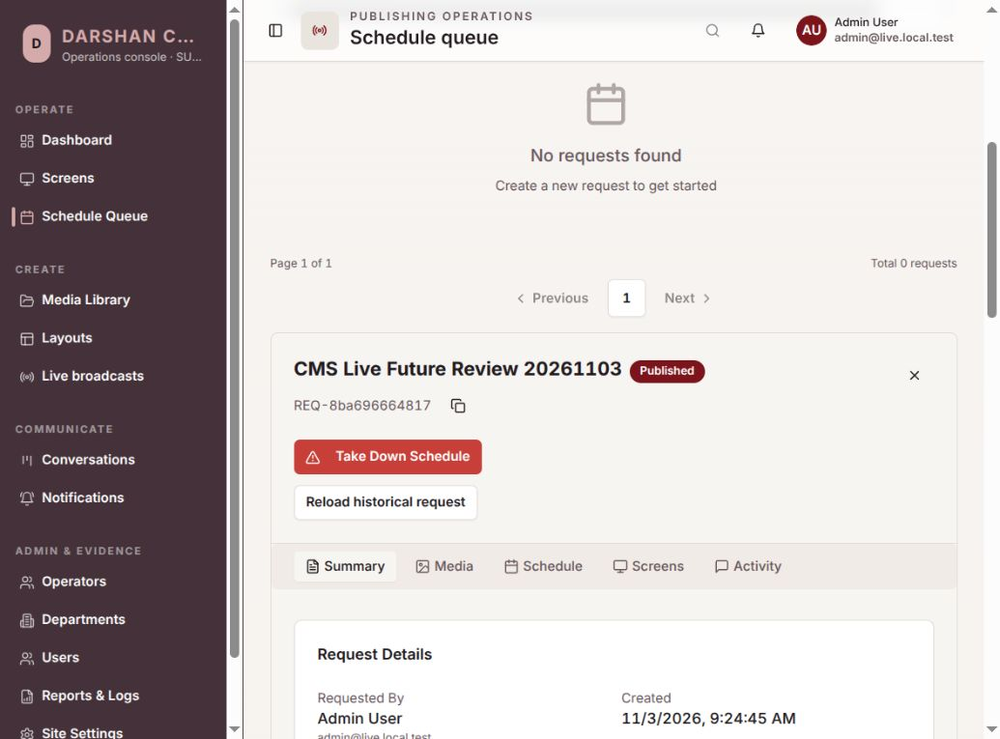
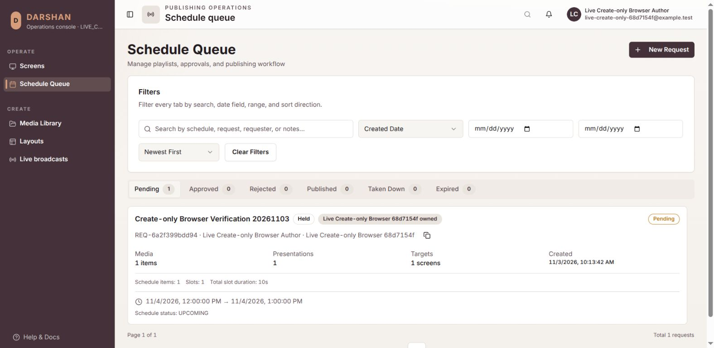
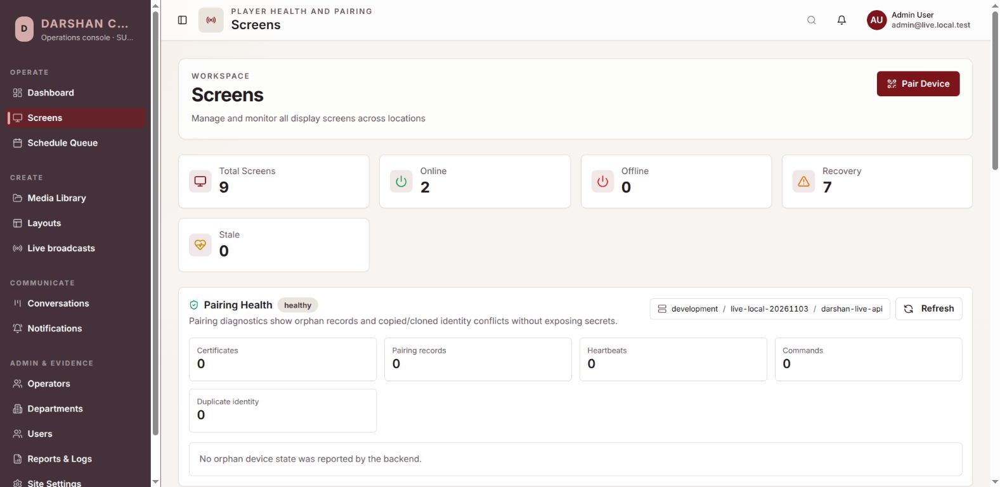
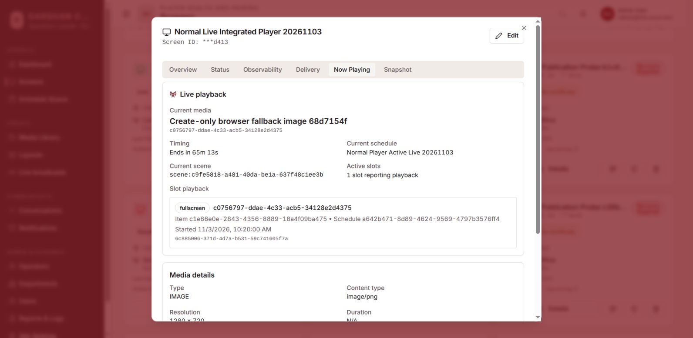

# Live runtime and authoring: developer verification, 2026-11-03

Status: **development verification in progress; no beta, release or human QA
approval**. This extends the source-scoped `8041a50` publication and `e546630`
recovery prerequisite reports. It does not replace their historical results
with results from a different executable.

The branch is `codex/live-screen-broadcast-planning-20261103`. The new runtime
is default OFF. Normal production player live capability remains withheld.
Final source-commit and artifact bindings will be added after the current
packet is committed. Do not interpret the existence of an API, component,
test or deployment script as an executed end-to-end acceptance test.

## Implemented behavior

- Backend run/admission authority uses the immutable published occurrence,
  current actor/session permissions and concrete frozen audience. Start,
  Stop and Enable have exact idempotent intent and an expected external
  authority epoch. Old-epoch intents cannot silently become new commands.
- Runtime occupancy is retained until matching physical teardown or a
  separately authenticated pinned-node death witness. Missing heartbeat,
  logical REVOKED and a new node's empty room list do not release old capacity.
- Media control and fresh nonce authority use verified HTTPS, bounded request
  and response-body deadlines, independent private inputs and boot/run/
  generation fences. Authority-file replacement fences the old process.
- Backend-mode media admission additionally requires independently advancing
  root-owned readiness pulses on a read-only tmpfs mount. Native host witness
  and watchdog processes own those pulses; the media container has no witness
  key or writable access to the host marker or proof outbox.
- The ordinary player's new main-process coordinator, restricted receiver
  view, content ownership, independent renderer lease and immutable fallback
  preparation are implemented. Tests and actual new-player runtime evidence
  are recorded separately below. This is not a separate installed receiver.
- The CMS has a four-step live authoring form, atomic retryable draft journal,
  prepared immutable fallback preview, frozen request review, occurrence
  controls, local presenter preview and distinct target diagnostics.
- Target reports expose current-run receiver connection, subscription, frame,
  audio and fallback facts separately. Server-received reports older than ten
  seconds, future timestamps, revoked identities and runtime mismatches become
  Unknown. The CMS also expires retained freshness while polling fails.
  These are player reports, not physical-display evidence or proof-of-play.
- Optional sixth-role signed/offline packaging is implemented. Ordinary
  five-role artifacts keep the feature OFF unless explicitly included and
  activated with properly provisioned target-only private files.

Source contracts: [authoring](../../docs/contracts/live-authoring.md),
[target reports](../../docs/contracts/live-target-reports.md),
[presenter controls](../../darshan-cms/docs/live-presenter-runtime.md),
[media deployment](../../docs/runbooks/live-media-vm-deployment.md).

## Actual CMS application journey

The running feature CMS at `https://localhost:18443` used real PostgreSQL,
MinIO, API and worker services. Browser controls, rather than API injection,
performed this journey:

1. Created `CMS Live Schedule Journey 20261103`, assigned the test administrator
   as presenter and left both audio permissions OFF.
2. Selected the existing test image presentation and observed preparation
   transition through Pending to Ready.
3. Selected one synthetic publication-probe screen. The protected paired
   baseline player was not selected.
4. Saved and reopened the draft; selections and absolute schedule times
   survived. Chose 4 November 2026, 10:00–11:00 in the browser's Kolkata time.
5. Reviewed saved revision 1 and observed the actual immutable image preview,
   labelled NORMAL CONTENT, render successfully.
6. Submitted one Schedule Request, opened Schedule Queue, checked the frozen
   presenter/audio/window/concrete audience and opened its historical fallback
   preview.
7. Used Approve & Publish and observed the request change to Published.

This future, synthetic-screen publication proves bounded authoring/review
behavior. It does not prove a live run, player download, decoded frame, audio,
capture permissions or transmission. A later browser journey used a create-only
custom authorization response from the real self-authorization endpoint and
successfully created a live request without exposing edit/delete controls. The
active normal-player publication was then inspected through `/screens`: its
ordinary image fallback was visibly current in Now Playing before any live run,
while the live report correctly remained No live run / No live attempt rather
than inventing a rendered frame.

An additional current-window journey was completed after activating exact
current CMS and Backend builds. The create-only operator used the real four-step
CMS form to prepare its owned immutable image fallback, selected only its owned
synthetic receiver, created `Local Live Runtime 20261103 1233`, acknowledged the
frozen review and submitted request `REQ-c82be3e75c96`. A separate SUPER_ADMIN
session reviewed the frozen presenter, audio, window, audience and fallback,
then used Approve & Publish. The request became Published and occurrence
`1d7fd748-8ff8-46ee-85a6-319404dc915e` became current. With every Media Node
container stopped, the assigned presenter then visibly observed all of the
following together:

- business eligibility `eligible`;
- media preflight `media unavailable`;
- `No trusted media node is currently reachable. Media capture remains disabled.`;
- disabled **Choose screen for local preview** and Start controls.

The preflight response was independently checked as read-only and bound to the
same occurrence, authority epoch, control revision and item fingerprint. It
reported `business_eligible=true`, `media_ready=false`, `capacity_ready=false`,
`ready=false`, and `reason=MEDIA_UNAVAILABLE`. No native chooser opened and no
capture permission was requested. This is actual no-node UX evidence, not a
media-ready, stream, frame, audio or player-display pass.

## Defects found during repeated review

| Defect | Correction and verification |
| --- | --- |
| Live form displayed quick presets without an action callback. | Render that card only when the caller supplies the existing callback; ordinary scheduling retains its working presets. |
| Draft Schedule edits checked a conditional role only against the old row. | Check both current and proposed Schedule values. A PostgreSQL regression first reproduced unauthorized success (200), then passed with 403 and unchanged schedule/item/journal. |
| A create-only author could review but could not acknowledge a saved read-only review. | Separate editing restrictions from confirmed-review consent and request notes. Actual control rendering has five focused cases; an independent create-only browser journey is being prepared. |
| Scheduling was offered without essential Schedule/Media read grants. | Require those coarse grants before exposing the entry action; record-bound backend permission checks remain authoritative. |
| Occurrence default dates depended on the CMS computer clock. | Initialize from a fresh authenticated backend nonce/time response; preserve explicit operator filters. |
| An isolated development player could modify the ordinary user's autostart entry. | Skip OS autostart management only for the validated owned live test profile; preserve normal development/QA/production behavior. |
| The CMS still derived feature navigation from a broad role-directory response. | Add a self-only authorization endpoint and make the CMS consume its own expanded capabilities. A create-only custom-role browser session proved the live action while preserving denied controls. |
| Existing browser fixtures mocked the old role-directory lookup but not the fail-closed self-authorization contract. | Add a canonical test helper with UUID-valid identities and exact expanded capabilities; update every affected fixture. This changes test identity setup, not production authorization. |
| The generated source-free CMS Nginx role served the PDF.js `.mjs` worker with `application/octet-stream`; Chromium rejected it and the actual document preview stayed unavailable. | Add an explicit `application/javascript mjs` location to the bundle assembler, retain the mapping in both direct-deployment templates, forbid an overriding `^~ /assets/` location, and cover all three variants in the production bundle test. The running QA CMS returned `Content-Type: application/javascript`; the focused document-preview journey then passed. |
| Native replacement media containers exited with code 137 while supervisor heartbeat and host-witness markers were still advancing; Docker reported no OOM. Host journal evidence places a Docker management-plane restart/resynchronization at the same boundary, while the root-only watchdog log is still required for an exact attribution. | Treat only `DOCKER_OPERATION_UNAVAILABLE` as a degraded management-plane condition after the exact local endpoint, full container identity and PID1 have been immutably pinned. Continue checking the held pidfd, supervisor heartbeat, watchdog cadence and independent root witness; any of those failing still enforces. Revalidate the complete identity/start fence when Docker recovers. Invalid Docker responses and identity/fence changes receive no outage treatment. Python units passed 20/20; the actual isolated-Docker regression kept a healthy SFU available beyond the superseded one-second cutoff and emitted a recovered full-fence event. |
| A host death witness could race the Backend's first media-health observation because a node was previously registered only while starting a run. Valid proof then received `LIVE_WITNESS_FENCE_MISMATCH` and could not clear its own outbox. | Register verified node health on every reconciliation, including idle boot; serialize health and witness handling with one node-scoped advisory lock; and allow a valid current-epoch witness that wins the race to create an already-dead node record. Focused PostgreSQL cases cover both orders and identity reuse rejection. After private build E activation, both retained native witnesses received HTTP 200 and their root helpers exited cleanly with evidence retained. |
| The isolated feature API omitted the realtime-enable setting while the owned player enabled signed `/device` connections. Socket.IO therefore rejected the unregistered namespace and the player correctly fell back to REST polling. | Production bundle and standalone server artifacts already enable realtime. Bring the ignored isolated activation profile into parity, reactivate the same immutable build and retain its prior containers. The player recorded a signed HELLO at `2026-11-03 05:23:45.017 UTC`, durable `lastRealtimeConnectedAt` at `05:23:45.056 UTC`, and continued signed HTTP. No later reconnect warning was present at the observation boundary. |
| The real presenter panel reported Start eligible and enabled **Choose screen** while no media node was accepting runs. Media discovery occurred only after native capture and Start, wasting user consent and leaving business eligibility mislabeled as operational readiness. | Add a separate read-only occurrence preflight bound to authority epoch, control revision and item fingerprint. It checks current business eligibility, trusted media readiness, participant headroom and the ten runtime slots without writes, tickets or node identity. CMS displays business and media state separately and cannot invoke the native chooser until that exact preflight is ready. Start retains all locked checks for later races. The exact-current focused CMS rerun passed 35/35 and the PostgreSQL/Fastify runtime suite passed 37/37. Exact-build browser repetition now passes the no-node half: business eligible, media unavailable and native chooser disabled. Media-ready repetition remains open. |
| The normal PlayerFlow LIVE unit fixture used an isolated `HEXMON_CONFIG_PATH` but did not neutralize an ambient `DARSHAN_PLAYER_CONFIG_FILE` or `SIGNHEX_PLAYER_CONFIG_FILE`. A developer shell with the packaged-player profile therefore overrode the fixture and deterministically failed authority construction. | Preserve, clear and restore all three supported config-path variables around the fixture. The formerly failing runtime-session binding case passed alone, then the focused normal-player LIVE unit/integration/fault packet passed 100/100 under the same ambient packaged-player environment. This is test-isolation evidence; it does not replace the outstanding real Electron media journey. |

## Supporting checks and build checkpoints

These are developer checks. Counts are separate executions and must not be
added together as unique coverage.

| Surface | Observed result / boundary |
| --- | --- |
| Backend runtime, epoch, transactional ability and redaction | 43 passed across four focused files. |
| Media-node boot/death-witness fencing and presenter preflight | The exact current database-backed runtime route suite passed 37/37 in 23.224 seconds, including read-only/redacted preflight states, runtime capacity, idle boot registration, witness-before-health, managed-ID reuse rejection and observed-dead reuse rejection. Its per-run database was dropped after pool closure. |
| Backend affected scheduling/security neighbors | 79 passed across seven files. |
| Fallback/atomic authoring routes, including conditional rename | 22/22 passed on an owned PostgreSQL database; fixture database dropped after pool closure. |
| Frozen request preview | 7/7 database-backed cases passed. |
| Current-run target diagnostics | 6/6 PostgreSQL/Fastify cases passed. |
| Complete CMS unit suite after consent/access fixes | 254/254 across 40 files passed; 40.72 seconds. A preceding broad-text assertion failure was corrected to inspect the actual scheduling button. |
| Focused presenter preflight CMS checks | Exact-current rerun: 35/35 across the validated API domain, presenter controller and media adapter. No-node preflight prevents `getDisplayMedia`; stale revision/fingerprint fails closed; Start remains authoritative after a ready-to-unavailable race. |
| Fresh screen lifecycle dry run | Final private build D passed all 12 steps against a fresh dedicated `_test` database and isolated job namespace. The live application database was not used or modified; retained disposable dry-run databases still require exact-target cleanup. |
| Private server build D | Literal `npm run build` passed in 29.271 seconds; exact copied inputs and migrations; 217 clean JavaScript files. Shared server dist was not changed. |
| Build D activation | Only feature API/worker replaced; readiness checks passed. Previous containers were retained for rollback. |
| Private server build E | Literal `npm run build` passed in 32.741 seconds from a stable exact private copy; 217 clean JavaScript files. It contains the media boot/death ordering correction and did not modify shared server dist. |
| Build E activation | Only feature API/worker were replaced. All six readiness checks returned healthy; rollback containers were retained. Both previously pending authenticated death witnesses were then acknowledged. The same immutable build was subsequently reactivated with the production-consistent realtime flag after the local-profile defect above; the armed Media node remained Ready. |
| Media Node current source | 108 passed / 9 opt-in skipped. The separate watchdog Python suite passed 20/20. Root metadata/mount fixtures do not prove actual native host operation. |
| Media Node actual Docker faults after management-outage correction | The healthy pinned-namespace Docker-inspection outage/recovery case passed and retained the SFU beyond the former one-second cutoff. Controller SIGSTOP, controller crash and forced-isolation neighbors then passed 3/3 at 1756/2000 ms, 78/2000 ms and 1554/3000 ms. Healthy-Docker host-watchdog PID1 STOP also passed in the broader attempt. Direct pidfd SIGKILL from the unprivileged Codex LSM context remained explicitly unconfirmed with `EACCES`; root/native-service evidence remains required. |
| Sixth-role packaging / host helpers | 18 configuration/Compose, 11 witness, 20 watchdog and five ordered watchdog-health checks passed. The generated role contains the health validator but excludes its test source. Source-free signed-role smoke passed both TLS modes using deliberately unrunnable skip-Docker fixtures. |
| Native root setup helper | Replacement instance `cbf890f5-67bf-47a2-bce1-986f4ce6a6ccb5` armed its root witness/watchdog; its media container then exited after 26 seconds with code 137 and Docker `OOMKilled=false`. Its death proof and the earlier retained proof were acknowledged after build E. Fresh instance `6012814f-81c7-494b-852e-d4e30f9019fd` later also exited 137 without OOM after first reaching Ready and accepting the real presenter's and receiver's admissions. The run converged to stopped/revoked state, but neither client established media and no frame/audio was observed. Advancing heartbeat/witness state immediately before exit and host journal evidence of a contemporaneous Docker management-plane restart motivated the corrected degradation contract above; exact attribution remains pending the root-only log. Corrected instance `11b6dcee-b78a-4995-9d2c-9fa1410fb62b` then armed both root loops, reached trusted Ready, registered with Backend as accepting runs, and stayed on one PID without restart/OOM while heartbeat, host-lease and witness sequences advanced for 354 seconds. The real in-app browser reached its private-LAN TLS signal endpoint with certificate verification and received the expected JSON 404 for an unauthenticated route. At `2026-11-03T05:44:48Z` that container exited 137 with Docker `OOMKilled=false`; its latest supervisor heartbeat, host lease and independent witness markers were all fresh immediately before exit. The host then had only about 235 MiB available and full swap. Root helpers exited cleanly and Backend accepted the resulting death witness, but the old local helper did not export the root-only watchdog event, so the exact stop reason remains unclaimed. The 1.5-second own-monitor gap policy is the only source path compatible with all observed fresh markers, but that remains an inference until the event log is read. Replacement `a426b9c4-ed3d-4db0-bd65-510f48ab0512` was then armed and launched. Its container started at `05:51:50Z`, never reached trusted Ready, and received a clean supervisor shutdown after 43 seconds (`ExitCode=0`, Docker `OOMKilled=false`). The user-readable helper status remained at `PREPARED_WAITING_CONTAINER`, so the exact root-only enforcement reason and the missing bounded status export remain unclaimed defects; this run is not successful media evidence. The capture picker was cancelled before selection, so no presenter publication, receiver frame or audio pass is claimed. |
| Ordinary player final packet | 559 unit, six integration and 22 fault checks passed on final source. Literal build and offline Linux unpacked packaging passed; shared baseline dist stayed byte-identical. A later exact-current focused LIVE packet first reproduced the ambient-config fixture defect above, then passed 100/100 after its isolation correction. The normal test player received the active ordinary fallback; actual live frame/audio evidence remains open. |
| CMS production and QA builds | Exact-source production and local-QA builds both passed the existing bundle budget. Earlier production build `f868d446-141f-4002-a9c9-7fbc46e0ff62` remains separate. The exact-current local QA build used for the no-node browser journey is `66cc7d42-402a-4e67-94c6-45a63c320f3a`; production lockdown was not represented by that browser profile. |
| CMS browser regression | Focused `/screens` coverage passed 8/8. The complete suite against the exact running QA artifact passed 43 with five credential-dependent chat journeys explicitly skipped; there were no failures. The corrected PDF preview was also rerun alone and passed. |
| Exact current no-node presenter journey | Current source was rebuilt and atomically activated after the running CMS/API mismatch was detected. CMS QA build `66cc7d42-402a-4e67-94c6-45a63c320f3a` and server build `b6a4f009-9a8d-4613-be42-2a91d68d4372` passed their immutable-input builds. Backend readiness passed database, migrations, bootstrap, MinIO, Valkey and worker. A fresh real presenter panel then visibly showed business eligible, media unavailable and a disabled native chooser for the current owned occurrence. |
| Production bundle configuration | 17/17 configuration tests passed after adding the `.mjs` MIME invariant to generated and direct CMS deployments and locking the Backend realtime-enable invariant for both source-free and standalone server artifacts. The running Nginx config validated before reload. |

Private server build D input SHA-256:
`00cc40a8c0b8d949901902588752295f6e85ef1bbaf9a154d4b0f6fdf0d91df8`.
Its JavaScript tree SHA-256 is
`5d083399980c4a6b350c2951b64247df8f401dddea22918ff7168ba6b1960ab7`.
Private server build E is
`43b3a9bf-87dd-4f54-90be-a15b0b603c8f`; its input SHA-256 is
`064f5a302a2cd28857e973f4731be38c03d8f82548002f90dca9839ce299f4b2`
and its 217-file JavaScript tree SHA-256 is
`a81a366ec685c984dd8fa6879451263ac04cb7f4c65ae5bbf1abbcbcdd8371de`.
The exact-current isolated API container is
`f6741bb259ca4778c49a17b51971318cca9c7c6a991cfd5817c56af071fd7961`
and worker container is
`24be6fbc7b4080666600712167ebad9ab49a4ff65554d66a8cd7b0e2dc9590c9`.
Their private build input SHA-256 is
`ed4beaab1c472a05a4362f2bdab336d51ad7eb7069455917ff5780d2fa749766`
and 217-file JavaScript tree SHA-256 is
`c00e18fc0b36f8732606632b24976ff914e1fe436fbc107f62549e210930c229`.
The exact-current CMS QA source-input SHA-256 is
`ae75989ee0e709d97f1c6a531453b64849b297660f5376e42093d185eeba8b83`
and QA output SHA-256 is
`7d5bb5cef5a7de6996eb45662456b0dbef7ada39eb86ddf8229504a799cd3a68`.
The earlier strict production output is
`8b6e9c460cc7b6b865185e002e3dab9a133aa27f00547fe07b906f4415a5a38a`
and was not used for this local browser journey.
The player source input is
`e3f1369ed68ac3a964acbef037f31ac27735068cb1ea385dcb935dddc4e03b00`,
compiled output is
`cc1d0aae9f5ce40c6653fcd9167dfd0b5fc22ce3253e9557efee2f0a427b39e3`
and packaged `app.asar` is
`de785a419e9781a92bbf29cd547c20a2f270ae297887b3ac47898cd1213c5c6a`.

The two normal-player fallback screenshots have SHA-256 values
`0d68e74f7413630309d512ff603b2f82a7a492738a6f866204a3eda53ff0d628`
and
`e038bc5e173c51dce5cef2a34cacd0a4ee61e476f2a77a562b6a0deaf47ebb9b`.
The isolated database migration ledger has 63 entries and no pending migration;
new additive migrations are 0060 and 0061. No other application database was
migrated by this packet.

An earlier actual SFU protocol/watchdog run observed a 1,830 ms termination
upper bound, but used the earlier `376028d7…` core. That result does **not**
verify the new mandatory host-readiness source or production Backend authority.
There is currently no accepting local media node: corrected instance
`11b6dcee-b78a-4995-9d2c-9fa1410fb62b`, node
`e0849480-5be9-47c4-a413-992e2c28909b`, exited after the bounded observation
above and Backend marked it dead. Its isolated verification image is
`sha256:97ea2a051f5c347599bc7de0c99ec62f5fdf2f14f5e33dc47c8d6585a44d5e4f`,
not a signed release artifact. Neither the earlier 70-second observation nor
the corrected 354-second idle observation is a successful media/frame/audio
enforcement test.

The strict production CMS build is preserved separately. Its existing
inspection heuristic locks in the embedded browser. Actual browser workflow
repeats use the repository's preexisting local QA compile setting
`VITE_ENABLE_PRODUCTION_LOCKDOWN=false`, recorded as a separate artifact
profile. Production inspection controls were not changed or verified by that
QA artifact. An initial private CMS activation also exposed unreadable web
asset modes from the restrictive private-build umask; activation now gives only
the hash-verified public dist normal read permissions. Private source, keys
and configuration retain their restrictive modes. Previous containers were
restored during failed activation and retained after success.

The first CMS TypeScript attempt exhausted its 512 MiB heap without completing;
it establishes no typecheck pass. Whole-project TypeScript also has documented
preexisting diagnostics and an installed-compiler `ignoreDeprecations` version
mismatch. A completed final check will be distinguished from those baseline
and resource constraints.

## Remaining local and external gates

Native root host loops require interactive sudo authentication on this machine;
passwordless sudo is unavailable. A fresh replacement handoff is prepared for
instance `f9e7482a-209b-4754-b336-e837ec04e198`, exact verification image
`sha256:97ea2a051f5c347599bc7de0c99ec62f5fdf2f14f5e33dc47c8d6585a44d5e4f`
and reviewed command
`.local/live-broadcast/native-live-root-replacement-command.txt`. Its root helper
has not started, so no Ready claim is made. No host security profile, ownership
guard, certificate verification or read-only mount rule was weakened.

Still required locally: actual Backend ↔ replacement media ↔ normal packaged player
journey, supported native chooser/cancellation/audio journeys, live/fallback/
emergency/stop/end/reconnect/failure observations and final artifact/source
bindings. The retained browser tabs are not evidence of a presenter state; no
OS chooser selection or permission result is claimed until the replacement
media node is healthy and a human selects only the intended DARSHAN test
surface.

External gates remain open: direct pidfd/AppArmor actuation, supported Windows
and actual Chrome/Edge/Firefox combinations, physical display/audio, whole-host
sleep with a separate Backend, cross-VM TLS/firewall/private TURN, production
restore and measured 10-broadcast/250-player capacity. No six-VM diagram or local
script result closes those gates.

QA catalogue integrity remains 150 cases, 51 risks and 152 trace rows. All
LIVE-01..20 remain **Not Tested**. QA-owned results, execution evidence, defect
IDs, actual results and existing checklist checkboxes are preserved.
